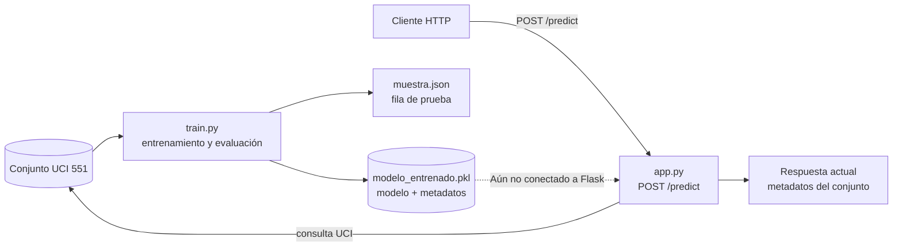
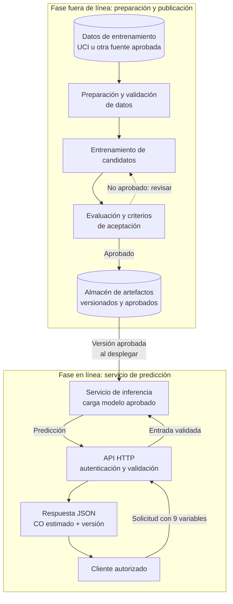

# AITurbidez

**AITurbidez** es una prueba de concepto de aprendizaje automático para
estimar la concentración de monóxido de carbono (`CO`) a partir de variables
de operación de una turbina de gas. El código de entrenamiento utiliza el
conjunto de datos UCI identificado como `551`.

> [!IMPORTANT]
> **Estado del proyecto:** el entrenamiento y el guardado local del artefacto
> están implementados. La API Flask todavía no carga el artefacto ni realiza
> predicciones: su ruta `POST /predict` consulta UCI y devuelve metadatos del
> conjunto. Los diagramas de arquitectura objetivo representan una evolución
> propuesta, no funcionalidades disponibles hoy.

## Índice

- [Alcance y estado](#alcance-y-estado)
- [Estructura del proyecto](#estructura-del-proyecto)
- [Requisitos y puesta en marcha](#requisitos-y-puesta-en-marcha)
- [Modelo de entrenamiento](#modelo-de-entrenamiento)
- [API disponible actualmente](#api-disponible-actualmente)
- [Arquitectura actual y objetivo](#arquitectura-actual-y-objetivo)
- [Separación entre entrenamiento e inferencia](#separación-entre-entrenamiento-e-inferencia)
- [Evolución del modelo](#evolución-del-modelo)
- [Acceso, propiedad intelectual y licencias](#acceso-propiedad-intelectual-y-licencias)

## Alcance y estado

El proyecto contiene dos flujos que hoy son independientes:

1. **Entrenamiento:** obtiene datos, prepara variables, entrena y evalúa
   modelos, y guarda el paquete del modelo junto a una muestra de prueba.
2. **API de demostración:** expone una ruta HTTP que devuelve información
   descriptiva del conjunto de datos. Aún no consume el modelo serializado.

Por lo tanto, ejecutar `python train.py` genera un artefacto local; no lo
publica ni lo conecta automáticamente con Flask. La integración de
predicciones en la API es trabajo futuro.

## Estructura del proyecto

| Archivo | Responsabilidad |
| --- | --- |
| `train.py` | Descarga los datos UCI, selecciona variables, entrena y evalúa los modelos y guarda resultados locales. |
| `app.py` | Aplicación Flask con `POST /predict`. Actualmente devuelve metadatos del conjunto UCI, no una predicción. |
| `requirements.txt` | Dependencias Python del proyecto. |
| `modelo_entrenado.pkl` | Artefacto binario generado por el entrenamiento; contiene el modelo y metadatos auxiliares. |
| `muestra.json` | Una fila de ejemplo con las variables de entrada. No es una predicción ni contiene el objetivo real. |

`modelo_entrenado.pkl` y `muestra.json` se crean al ejecutar el entrenamiento y
se guardan en la carpeta del proyecto. El archivo `.pkl` puede ser grande y no
está diseñado para edición manual. **Solo se deben cargar archivos pickle de
origen confiable**, porque deserializarlos puede ejecutar código.

## Requisitos y puesta en marcha

Se requiere Python y conexión a Internet para descargar el conjunto de datos
desde UCI. En PowerShell, desde la raíz del proyecto:

```powershell
python -m venv venv
.\venv\Scripts\Activate.ps1
python -m pip install -r requirements.txt
python train.py
```

El entrenamiento genera o reemplaza `modelo_entrenado.pkl` y `muestra.json`.
También imprime las métricas de evaluación, una fila de prueba, el valor real
de `CO` para esa fila y las predicciones del modelo y de referencia.

Para iniciar la API de demostración:

```powershell
python app.py
```

La aplicación escucha en el puerto `5000`. La configuración actual activa el
modo de depuración y escucha en todas las interfaces; úsese únicamente para
desarrollo local y no se exponga directamente a Internet o a redes no
confiables.

## Modelo de entrenamiento

### Datos y variables

El objetivo de regresión es `CO`. El modelo recibe estas nueve variables, en el
orden guardado en el artefacto:

| Variable | Descripción |
| --- | --- |
| `AT` | Temperatura ambiente |
| `AP` | Presión ambiente |
| `AH` | Humedad ambiente |
| `AFDP` | Presión diferencial del filtro de aire |
| `GTEP` | Presión de escape de la turbina de gas |
| `TIT` | Temperatura de entrada de la turbina |
| `TAT` | Temperatura de salida de la turbina |
| `TEY` | Energía de salida de la turbina |
| `CDP` | Presión de descarga del compresor |

Los nombres y descripciones corresponden a las variables seleccionadas por el
proyecto; para interpretaciones de ingeniería y unidades, consúltese la
documentación original del conjunto UCI.

### Entrenamiento y evaluación implementados

`train.py` comprueba que las variables seleccionadas no tengan valores
ausentes y divide los datos **sin mezclar las filas**: 60 % para entrenamiento
y 40 % para prueba. Entrena dos estimadores:

- **Random Forest (`RandomForestRegressor`)** con 100 árboles: modelo principal
  para la estimación de `CO`.
- **Dummy (`DummyRegressor`)** que predice el promedio: referencia sencilla
  para comparar el valor del modelo principal.

El script calcula `R²` y el error absoluto medio (`MAE`) para Random Forest.
Estas métricas permiten una evaluación inicial, pero no garantizan por sí
solas que el modelo generalice a otros períodos, turbinas o condiciones de
operación.

### Contenido del artefacto

El diccionario guardado en `modelo_entrenado.pkl` contiene:

| Clave | Contenido |
| --- | --- |
| `modelo` | Random Forest entrenado. |
| `referencia` | Dummy de referencia entrenado. |
| `entradas` | Nombres y orden esperado de las variables de entrada. |
| `objetivo` | Nombre de la variable estimada: `CO`. |

Para inferir, un consumidor debe cargar el artefacto confiable con `joblib`,
construir una tabla que contenga todas las variables en el formato esperado y
usar `paquete["modelo"].predict(datos)`. Esa lógica aún no está integrada en
`app.py`.

## API disponible actualmente

La ruta disponible es `POST /predict`. En su estado actual, la aplicación:

1. Consulta el conjunto UCI durante la petición.
2. Comprueba que los datos originales estén disponibles.
3. Devuelve nombres de columnas y dimensiones de los datos.

No valida un cuerpo de solicitud para predicción, no carga
`modelo_entrenado.pkl` y no devuelve una estimación de `CO`. En consecuencia,
la ruta debe considerarse **demostrativa**, no un endpoint de inferencia listo
para clientes.

## Arquitectura actual y objetivo

### Implementación actual



El diagrama distingue el flujo ya implementado del enlace punteado que todavía
no existe. Actualmente la API depende de UCI en cada petición y no utiliza el
modelo guardado.

### Arquitectura objetivo propuesta



El flujo objetivo separa la producción y aprobación del modelo de las
peticiones de usuarios. En producción, el servicio cargaría un artefacto
aprobado y versionado; cada petición enviaría las nueve variables, la API las
validaría y el servicio devolvería la estimación y la versión utilizada. Este
flujo es una propuesta de arquitectura y aún requiere implementación,
pruebas, autenticación, gestión de versiones y despliegue.

### Estructura de código propuesta

La siguiente estructura es orientativa; no representa carpetas existentes:

```text
AITurbidez/
├── src/
│   ├── api/                 # HTTP, validación y respuestas
│   ├── inference/           # carga del modelo y predicción
│   └── training/            # datos, entrenamiento y evaluación
├── artifacts/               # versiones aprobadas y metadatos
├── tests/                   # pruebas de API, datos e inferencia
├── app.py                   # inicio del servicio API
├── train.py                 # inicio del proceso de entrenamiento
└── requirements.txt
```

## Separación entre entrenamiento e inferencia

Entrenar y servir predicciones tienen necesidades distintas. El entrenamiento
puede consumir muchos recursos, acceder a datos de desarrollo y producir
artefactos; la inferencia debe responder de forma predecible y usar solo
versiones aprobadas. Mantenerlos como procesos independientes permite:

- evitar que una petición HTTP inicie o altere un entrenamiento;
- evaluar y aprobar un modelo antes de publicarlo;
- actualizar o revertir la versión del modelo sin cambiar necesariamente la
  API;
- restringir por separado el acceso a datos, código de entrenamiento y
  artefactos de producción;
- escalar el servicio de inferencia según la demanda, si el uso lo requiere.

La separación lógica **no obliga** a desplegar microservicios. En una primera
versión, la API y la inferencia pueden ser módulos en un mismo proceso, con el
modelo cargado al iniciar. Ejecutar inferencia en otro proceso o servicio
puede aportar aislamiento y escalado independiente, pero también añade
latencia de red y complejidad de disponibilidad, autenticación, monitorización
y despliegue. La decisión debe responder a requisitos reales y medibles.

## Evolución del modelo

Random Forest es una primera opción razonable para datos tabulares: aprende
relaciones no lineales y permite establecer una referencia sin diseñar una red
neuronal desde el inicio. El `DummyRegressor` ayuda a determinar si el modelo
principal mejora una predicción trivial.

La arquitectura del modelo no es definitiva. El equipo podría comparar
métodos de boosting u otras alternativas, incluidas redes neuronales, si los
datos, el volumen y el caso de uso lo justifican. Un cambio debe basarse en
evaluación reproducible, comparación con una línea base, validación en datos
representativos y revisión del impacto operativo. Deep learning no implica
automáticamente mejores resultados para datos tabulares.

## Acceso, propiedad intelectual y licencias

La intención de gobierno del proyecto es que **solo integrantes autorizados
por el equipo puedan modificar el código o aprobar cambios de arquitectura**.
Quienes necesiten consultar el proyecto, pero no contribuir, deberían recibir
acceso de solo lectura y únicamente a los recursos necesarios.

La intención de compartir el modelo separadamente del código debe entenderse
como una decisión de distribución y permisos, no como una propiedad automática
del archivo `.pkl`:

- El artefacto `.pkl` no es, por sí mismo, una licencia ni convierte al modelo
  en “open source”. La distribución debe especificar qué se comparte y qué
  usos, modificaciones o redistribuciones se permiten.
- Este repositorio contiene `train.py` y `app.py`; por ello, el código fuente
  está presente en el proyecto. El acceso efectivo depende de los permisos
  configurados para el repositorio y los sistemas de almacenamiento.
- No se identificó un archivo de licencia en la raíz del proyecto. Hasta que
  el equipo apruebe los términos y añada las licencias correspondientes, no se
  debe afirmar que el código es legalmente cerrado ni que el modelo es
  legalmente abierto.
- Documentar la arquitectura no impide que alguien la lea, la copie o la
  implemente por separado. Las restricciones de acceso requieren controles
  técnicos; la confidencialidad, propiedad intelectual y redistribución
  requieren términos legales apropiados.
- Antes de compartir datos o modelos derivados, se deben revisar la
  procedencia y las condiciones de uso del conjunto UCI y de las dependencias.

Los permisos de lectura y escritura deben configurarse en el proveedor del
repositorio y en el almacén de artefactos. Este README expresa la política
prevista, pero no impone controles técnicos ni sustituye una licencia, un
acuerdo de confidencialidad o asesoría legal. El equipo responsable debe
aprobar los términos antes de distribuir externamente código, datos o modelos.
